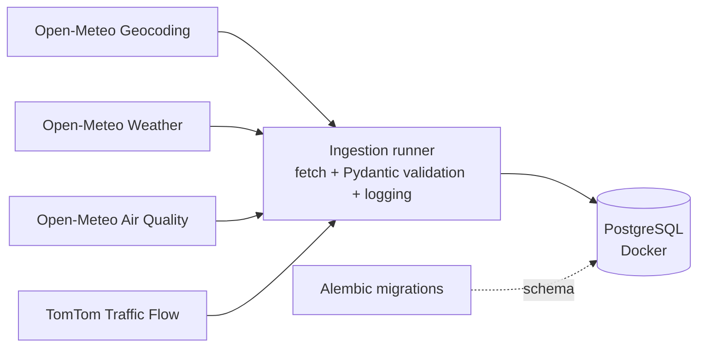

# Urban Data Pipeline

> Formerly **CityPulse**.

A Python ETL pipeline that collects **weather**, **air quality** and **traffic** snapshots for Ukrainian cities from public APIs, validates the responses and stores them in PostgreSQL. The database schema is versioned with Alembic and the whole environment runs in Docker.

Currently configured for **Kyiv** and **Lviv**; the list of cities is a single config file (`src/config.py`).

## Architecture



Each source (`weather`, `air_quality`, `traffic`) is a separate module with its own `fetch_*` and `insert_*` functions. A shared runner (`src/ingestion_runner.py`) handles the common flow: geocode the city, fetch data, validate it, insert it, log the result.

**Design decisions**
- **Validation at the boundary.** Every API response is parsed with a Pydantic model before it touches the database.
- **A failure for one city does not stop the run.** The error is logged, the transaction is rolled back and the runner moves on to the next city.
- **Geocoding is disambiguated** by country and region (e.g. `Lviv Oblast`), so a city name is never matched to the wrong place.
- **The city dimension is upserted** with a single `INSERT ... ON CONFLICT DO UPDATE ... RETURNING id`.
- **Logs are written per source** (`logs/weather.log`, `logs/air_quality.log`, `logs/traffic.log`).

## Data sources

| Source | Provider | Collected fields | Table |
|---|---|---|---|
| Geocoding | Open-Meteo Geocoding API | city name → latitude, longitude, country, region | `cities` |
| Weather | Open-Meteo Forecast API | temperature, relative humidity, wind speed, weather code | `weather_data` |
| Air quality | Open-Meteo Air Quality API | PM10, PM2.5, carbon monoxide | `air_quality` |
| Traffic | TomTom Traffic Flow API | current speed, free-flow speed, current and free-flow travel time, road closure flag | `traffic_data` |

Traffic data describes the road segment closest to the city coordinates, not the whole city.

## Data model

```
cities (id, city_name, latitude, longitude, country, region)
   ├── weather_data  (id, city_id → cities.id, recorded_at, temperature, relative_humidity, wind_speed, weather_code)
   ├── air_quality   (id, city_id → cities.id, recorded_at, pm10, pm2_5, carbon_monoxide)
   └── traffic_data  (id, city_id → cities.id, recorded_at, current_speed, free_flow_speed,
                      current_travel_time, free_flow_travel_time, road_closure)
```

Foreign keys on `city_id` are indexed. Each run appends one snapshot per city per source.

## Tech stack

Python · PostgreSQL 16 · Docker / Docker Compose · Alembic · psycopg2 · Pydantic · Requests · Ruff

## Project structure

```
.
├── alembic/                 # migrations (full schema history)
│   └── versions/
├── src/
│   ├── config.py            # list of target cities
│   ├── db.py                # DB connection, city upsert
│   ├── geocoding.py         # city name → coordinates
│   ├── ingestion_runner.py  # shared fetch → validate → insert flow
│   ├── weather/ingestion.py
│   ├── air_quality/ingestion.py
│   └── traffic/ingestion.py
├── docker-compose.yml       # PostgreSQL service
├── alembic.ini
├── requirements.txt
└── .dist.env                # template for environment variables
```

## Getting started

**Prerequisites:** Python 3.10+, Git, Docker Desktop (running), a free [TomTom developer API key](https://developer.tomtom.com/). The Open-Meteo APIs need no key.

**1. Clone and install**

```bash
git clone https://github.com/IrynaKilyk/urban-data-pipeline.git
cd urban-data-pipeline

python -m venv venv
# Windows (PowerShell): .\venv\Scripts\Activate.ps1
# macOS / Linux:        source venv/bin/activate

pip install -r requirements.txt
```

**2. Configure environment variables**

```bash
cp .dist.env .env      # Windows (PowerShell): copy .dist.env .env
```

Fill in `.env`:

| Variable | Description |
|---|---|
| `POSTGRES_USER` / `POSTGRES_PASSWORD` / `POSTGRES_DB` | Database credentials of your choice |
| `POSTGRES_HOST` | `localhost` |
| `POSTGRES_PORT` | `5433` (the port mapped in `docker-compose.yml`) |
| `TOMTOM_API_KEY` | Your TomTom API key |

**3. Start PostgreSQL and create the schema**

```bash
docker-compose up -d
alembic upgrade head
```

**4. Run the pipeline**

Each source is run as a module, from the project root:

```bash
python -m src.weather.ingestion
python -m src.air_quality.ingestion
python -m src.traffic.ingestion
```

Example log output (`logs/weather.log`):

```
2026-09-06 20:23:25 - INFO - Connecting successfully
2026-09-06 20:23:26 - INFO - [weather] Information about city Kyiv successfully saved!
2026-09-06 20:23:26 - INFO - [weather] Information about city Lviv successfully saved!
2026-09-06 20:23:26 - INFO - Connection with bd closed!
```

**5. Check the data**

```sql
SELECT c.city_name, w.recorded_at, w.temperature, w.wind_speed
FROM weather_data w
JOIN cities c ON c.id = w.city_id
ORDER BY w.recorded_at DESC
LIMIT 5;
```

Traffic congestion (1.0 means free-flowing, lower means slower than normal):

```sql
SELECT c.city_name, t.recorded_at,
       ROUND(t.current_speed::numeric / t.free_flow_speed, 2) AS speed_ratio
FROM traffic_data t
JOIN cities c ON c.id = t.city_id
ORDER BY t.recorded_at DESC
LIMIT 5;
```

## Database migrations

Alembic is the single source of truth for the schema; `alembic/versions/` holds its full history.

```bash
alembic revision -m "short description of the change"   # create
alembic upgrade head                                     # apply
alembic current                                          # check state
```

## Code quality

Linting and import sorting with [Ruff](https://docs.astral.sh/ruff/); line endings are normalized to LF (`.gitattributes`).

```bash
ruff check src/
ruff check --fix src/
```

Development follows a feature-branch + pull request workflow with Conventional Commits.

## Roadmap

- [ ] Idempotent inserts: unique constraint on `(city_id, recorded_at)` + `ON CONFLICT DO NOTHING`
- [ ] Unit tests (`pytest`) for validation and parsing, and CI with GitHub Actions
- [ ] Scheduled runs with Apache Airflow
- [ ] Analytical models and data quality tests with dbt
- [ ] Add more cities

## License

MIT, see [LICENSE](LICENSE).
